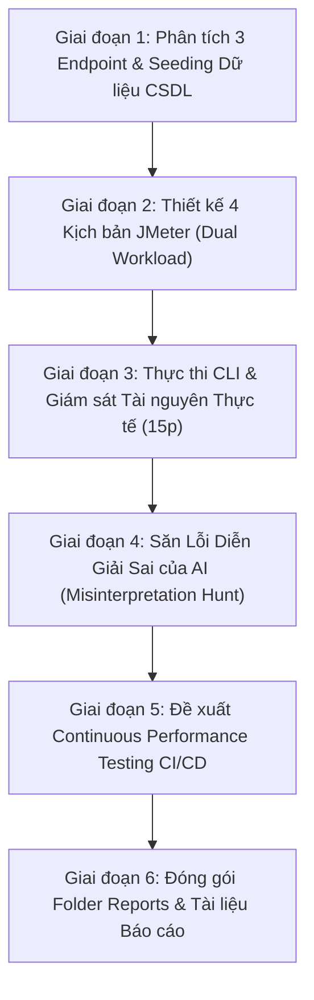

# Hướng dẫn Kiểm thử Hiệu năng Toàn diện (HW05 Performance Testing)

Skill này đóng gói toàn bộ quy trình, phương pháp luận kỹ thuật và bộ công cụ tự động hóa để thực hiện bài tập **HW05 – Performance Testing** cho bất kỳ luồng nghiệp vụ API nào của hệ thống SUT EShop Backend.

---

## 1. Cách kích hoạt & Cú pháp sử dụng (Trigger Syntax)

Người dùng kích hoạt skill bằng câu lệnh:
```text
sử dụng skill để làm luồng <tên_luồng>
```
*Ví dụ:*
- `sử dụng skill để làm luồng Quản trị viên xử lý đơn hàng (Admin Order Fulfillment)`
- `sử dụng skill để làm luồng Khách hàng hủy đơn và hoàn tiền`
- `sử dụng skill để làm luồng Khách hàng thẩm định mã giảm giá (Coupon Validation)`

---

## 2. Tiêu chuẩn Đầu ra (Output Deliverables Checklist)

Mỗi lần thực thi luồng theo skill, agent bắt buộc phải tạo ra và xác nhận đầy đủ các sản phẩm sau:

```text
23120045_HW05/
├── 23120045_Load_<YYYYMMDD>.jmx        # Kịch bản Load Testing (Summary Report listener)
├── 23120045_Stress_<YYYYMMDD>.jmx      # Kịch bản Stress Testing (Aggregate Report listener)
├── 23120045_Spike_<YYYYMMDD>.jmx       # Kịch bản Spike Testing (View Results Tree listener)
├── 23120045_Soak_<YYYYMMDD>.jmx        # Kịch bản Soak Testing 15 phút (Summary Report)
├── data/
│   ├── admin_credentials.csv           # Dữ liệu xoay vòng đa tài khoản hợp lệ
│   ├── attacker_credentials.csv        # Dữ liệu mật khẩu sai kích hoạt lockout
│   └── orders_dataset.csv              # 10.000 bản ghi dữ liệu kiểm thử
├── reports/
│   ├── load/ (results.jtl & html/)     # Kết quả đo tải thông thường
│   ├── stress/ (results.jtl & html/)   # Kết quả đo giới hạn quá tải
│   ├── spike/ (results.jtl & html/)    # Kết quả đo đột biến tải tức thời
│   └── soak/
│       ├── results.jtl                 # File log raw bài test bền vững 15 phút
│       ├── system_resources.csv        # Nhật ký đo đạc CPU, RAM thực tế mỗi 5s
│       └── html/                       # Dashboard HTML tương tác của bài Soak test
├── scripts/
│   ├── seed_orders.js                  # Script nạp 10.000 bản ghi dữ liệu pending & tài khoản
│   ├── reset_lockout.js                # Script tự phục hồi và mở khóa CSDL
│   ├── monitor_resources.py            # Script đo CPU, RAM Node.js & JMeter theo thời gian thực
│   └── run_soak_test.py                # Script điều phối thực thi 15 phút Soak test
├── Main_Report.md                      # Báo cáo chính hoàn chỉnh (Task 1, 2, 3)
├── README.md                           # Bảng tự đánh giá 100/100 theo chuẩn Mục 15 đề bài
├── AI_Audit_Report.md                  # Nhật ký tương tác AI (Gemini 3.8 Flash High)
└── AI_Critique.md                      # Đoạn văn phản biện AI đạt chuẩn 200–300 từ
```

---

## 3. Quy trình 6 Giai đoạn Thực hiện (Detailed Workflow)



---

### Giai đoạn 1: Phân tích Endpoint & Chuẩn bị Dữ liệu (Data Seeding)

1. **Phân loại 3 nhóm Endpoint bắt buộc**:
   - **Auth-heavy:** Bắt buộc có cơ chế xác thực JWT và cơ chế khóa tài khoản khi sai mật khẩu $\ge 3$ lần liên tiếp (`locked_until`). Ví dụ: `POST /api/login`.
   - **Read-heavy:** Câu truy vấn đọc nặng nhất hệ thống, ưu tiên câu lệnh có `JOIN` nhiều bảng, không phân trang hoặc sắp xếp phức tạp. Ví dụ: `GET /api/admin/orders`.
   - **Transactional:** Thao tác ghi dữ liệu có biến đổi trạng thái (State Transition) tuân theo ràng buộc máy trạng thái (Order State Machine) hoặc kiểm tra khóa ngoại. Ví dụ: `PUT /api/admin/orders/:id/status`.
   - *Lưu ý ràng buộc đề bài:* Tuyệt đối không chọn luồng giỏ hàng / checkout cơ bản để tránh trùng lặp.
2. **Chiến lược nạp dữ liệu nền (Data Seeding)**:
   - Viết script `seed_orders.js` nạp sẵn **10.000 bản ghi pending** vào CSDL trước khi test để đảm bảo các thao tác chuyển trạng thái không bị lỗi `HTTP 400 Invalid state transition`.
   - Tự động tạo 6 tài khoản admin hợp lệ (`admin@eshop.com`, `admin1` .. `admin5`) và 1 tài khoản nạn nhân (`victim_admin@eshop.com`).
3. **Script tự phục hồi Lockout (`reset_lockout.js`)**:
   - Cung cấp cơ chế tự động bù đắp tài khoản nếu CSDL bị reset.
   - Xóa bỏ khóa: `UPDATE users SET login_attempts = 0, locked_until = NULL`.

---

### Giai đoạn 2: Thiết kế 4 Kịch bản JMeter (Dual Workload Architecture)

Đọc tài liệu tham chiếu `references/workload-modeling.md` để nắm rõ cấu trúc Thread Group.

1. **Giải quyết bài toán khóa tài khoản 3-fail lockout**:
   - Nếu dùng 1 tài khoản duy nhất: khi bị khóa, toàn bộ các request sau bị sập dây chuyền (cascading failure) do không lấy được Token.
   - **Giải pháp bắt buộc: Kiến trúc Workload kép (Dual Thread Groups)**:
     - **TG01 (Luồng chính đo tải):** Sử dụng đa tài khoản từ `admin_credentials.csv` (`recycle=true`) để chuỗi request Đăng nhập $\rightarrow$ Đọc $\rightarrow$ Ghi chạy thông suốt ở mức tải cao.
     - **TG02 (Luồng giả lập tấn công Brute-force):** 5 luồng gửi mật khẩu sai liên tục vào `victim_admin@eshop.com` từ `attacker_credentials.csv` để kích hoạt trạng thái `locked_until` (nhận mã đỏ HTTP 401 và HTTP 403 Forbidden).
2. **Cấu hình 4 kịch bản chuẩn**:
   - **Load Testing (`23120045_Load_<YYYYMMDD>.jmx`):** 20 threads, Ramp-up 10s, Gaussian Think-time (1200±500ms), Listener: **Summary Report**.
   - **Stress Testing (`23120045_Stress_<YYYYMMDD>.jmx`):** 80 threads (75 TG01 + 5 TG02), Ramp-up 15s, Uniform Think-time (200±200ms), Listener: **Aggregate Report**.
   - **Spike Testing (`23120045_Spike_<YYYYMMDD>.jmx`):** 120 threads (115 TG01 + 5 TG02), Ramp-up 3s (tăng đột biến), Constant Think-time (50ms), Listener: **View Results Tree**.
   - **Soak Testing (`23120045_Soak_<YYYYMMDD>.jmx`):** 15 threads bền vững, thời gian chạy **900 giây (15 phút liên tục)**, Gaussian Think-time (1200±500ms), Listener: **Summary Report**.

---

### Giai đoạn 3: Thực thi CLI & Giám sát Tài nguyên Thực nghiệm

Đọc tài liệu tham chiếu `references/monitoring-and-soak.md`.

1. **Khởi chạy kiểm thử phi giao diện (Non-GUI CLI)**:
   ```powershell
   jmeter -n -t <TestPlan>.jmx -l reports/<scenario>/results.jtl -e -o reports/<scenario>/html
   ```
2. **Đo đạc tài nguyên thực tế với `monitor_resources.py`**:
   - Tự động dò tìm PID của backend Node.js (cổng 3000) và `java.exe` (JMeter).
   - Đo chu kỳ mỗi 5 giây: CPU %, RAM Working Set (MB), RAM Private Bytes, CPU tổng thể máy tính.
   - Ghi dữ liệu thực tế vào `reports/soak/system_resources.csv`.
   - Kiểm định Memory Leak: Đánh giá độ dốc tăng trưởng bộ nhớ qua 15 phút.

---

### Giai đoạn 4: Săn Lỗi Diễn Giải Sai của AI (Misinterpretation Hunt — Task 2)

Đọc tài liệu tham chiếu `references/misinterpretation-hunt.md`.

1. **Yêu cầu AI phân tích file `.jtl` thô**:
   - Trích xuất: Throughput, Latency phân vị (p90, p95, p99), Error Rate.
2. **Sinh viên thực hiện Human Review bóc trần ảo giác AI**:
   - **Bẫy 1 — Ngụy biện số trung bình (Average Flaw):** AI khen hệ thống mượt mà vì Mean Latency thấp, bỏ qua p95 và tỷ lệ lỗi cao.
   - **Bẫy 2 — Ảo giác quy chụp nguyên nhân lỗi (Fault Misattribution):** AI thấy lỗi ở thao tác ghi liền quy chụp là "500 SQLite lock/busy", sinh viên đối chiếu cột `responseCode` trong `.jtl` chứng minh 100% là lỗi **HTTP 400 Bad Request** do vi phạm máy trạng thái State Machine.
   - **Bẫy 3 — Ảo giác đề xuất tối ưu (Hallucinated Recommendations):** Phân loại đề xuất máy móc (Connection Pool cho SQLite là **HALLUCINATED**, SQLite WAL mode và Phân trang `LIMIT/OFFSET` là **FEASIBLE**).

---

### Giai đoạn 5: Đề xuất Continuous Performance Testing (Task 3 — Disrupt G9.6)

1. Thiết kế Pipeline GitHub Actions tự động kích hoạt khi có commit sửa đổi backend/database.
2. Thiết lập Quality Gate chặn PR tự động:
   - $p95$ Latency tăng $> 10\%$ so với nhánh `main`.
   - Tỷ lệ lỗi $> 1.0\%$.
3. Vẽ sơ đồ luồng Mermaid đầy đủ các bước phân loại (Path filter), dựng môi trường Docker, nạp dữ liệu và kiểm tra Quality Gate.
4. Bảng phân tích trade-offs chi tiết: Thời gian phản hồi, chi phí hạ tầng, và giải pháp triệt tiêu cảnh báo giả (False Alarms).

---

### Giai đoạn 6: Đóng gói và Hoàn thiện Báo cáo

1. Điền đầy đủ số liệu thực tế đo đạc được vào `Main_Report.md`.
2. Chuẩn hóa `README.md` theo đúng bảng tự đánh giá 100/100 mẫu tại Mục 15 đề bài.
3. Soạn thảo `AI_Critique.md` nghiêm túc trong khoảng **200–300 từ**.
4. Nén toàn bộ thư mục thành file: `{StudentID}_HW05_AI_Performance_100.zip`.
